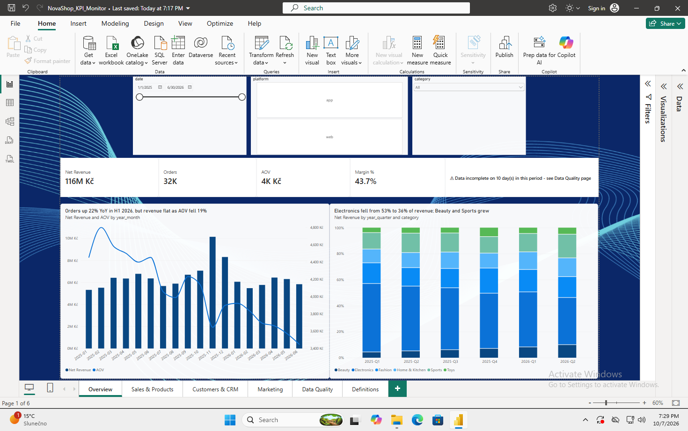
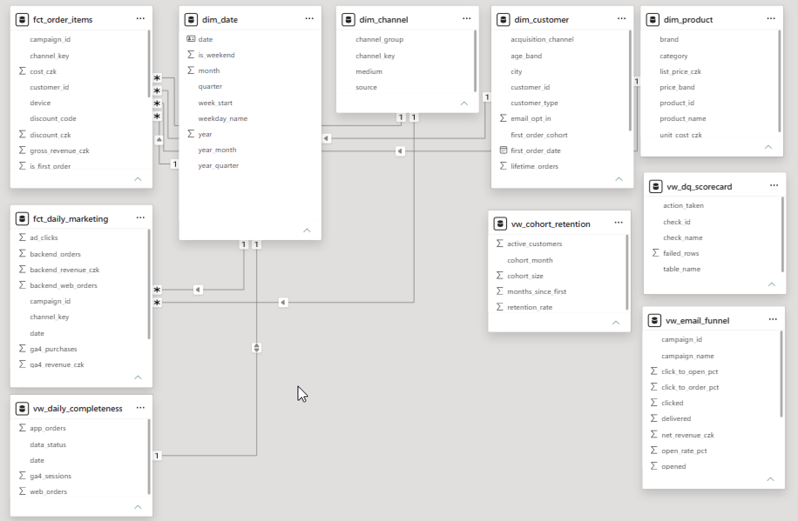
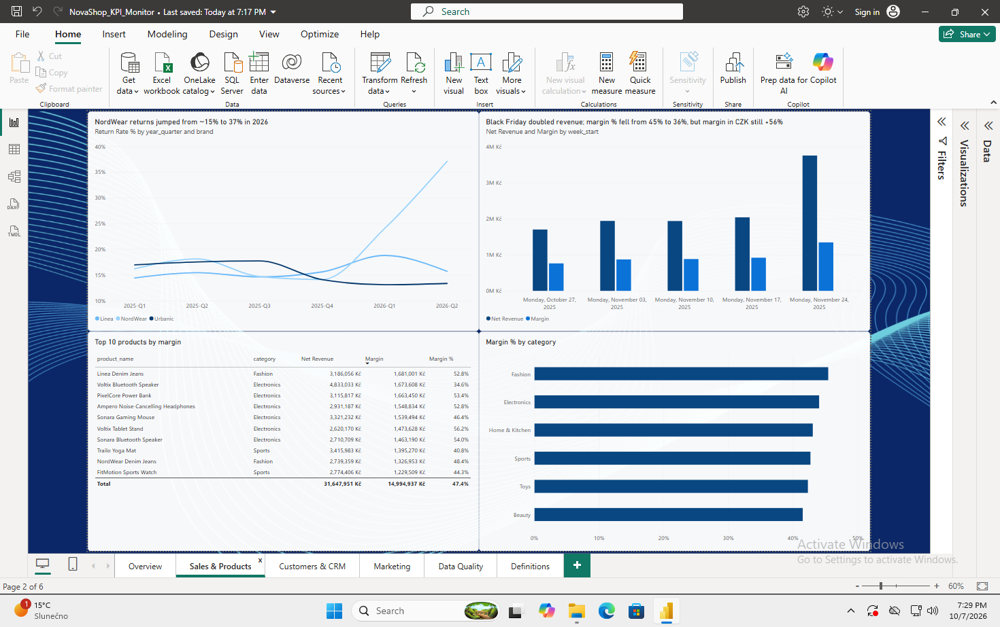
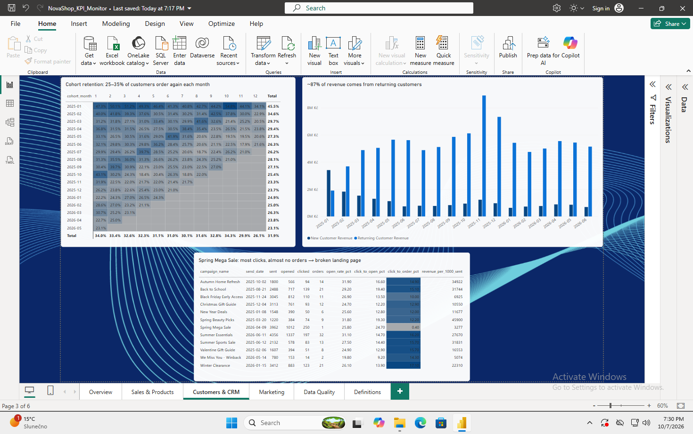
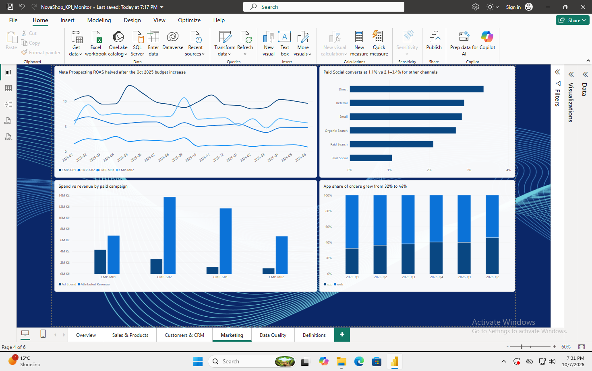
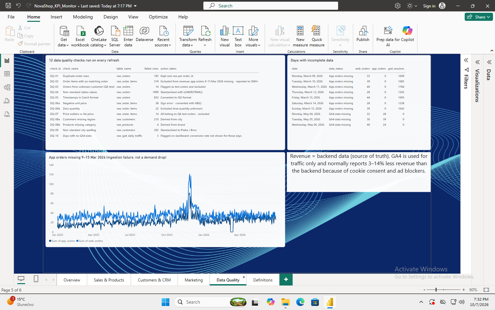
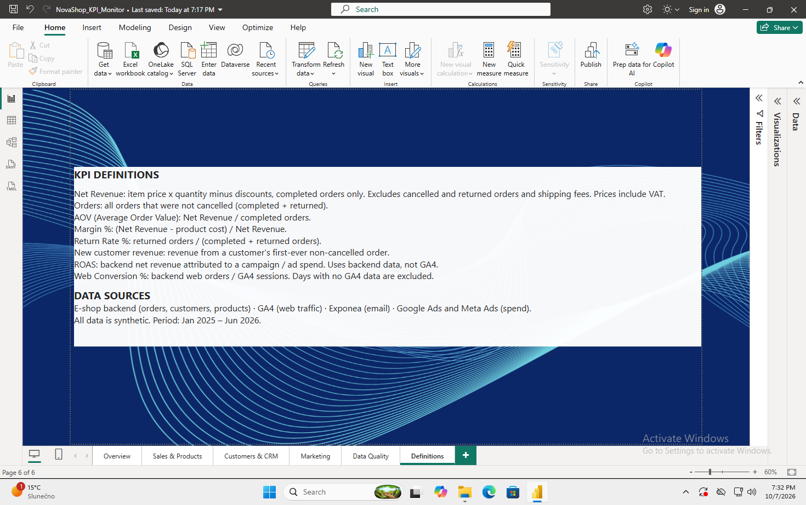

# NovaShop.cz: Online Retail KPI Monitor

**End-to-end BI project: business requirements → SQL data model → data quality checks → Power BI dashboard → recommendations**



## The business problem
NovaShop.cz is a (fictional) Czech online retailer that sells through a web shop and a mobile app. Three teams (Sales, CRM and E-commerce) each report numbers from different tools (backend, GA4, Exponea, ad platforms), and **the numbers don't match**. I built a single, reliable reporting layer and dashboard so every team works from the same definitions.

## Key findings
1. **Orders +22%, but revenue −2% (H1 2026 vs H1 2025):** AOV fell 19% as Electronics dropped from 53% to 36% of revenue → review Electronics pricing and test bundles to lift AOV.
2. **Meta Prospecting ROAS halved (2.4 → 1.2) after its budget doubled in Oct 2025**, below break-even at a 44% margin → move ≈0.75M CZK per half-year to campaigns with ROAS 6–10.
3. **A revenue "drop" in March 2026 was a data problem, not a business problem:** all app orders for one week were missing from the load, which I proved from 319 orphan order lines → flagged on the dashboard and reported with 5 fixes for the data warehouse team.

Other findings: NordWear return rate rose from ~15% to 37%; one email campaign had the most clicks but almost no orders (broken landing page). See the [insights summary](docs/insights_summary.md).

## What I did
| Step | Output |
|---|---|
| 1. Gathered requirements from 3 stakeholders | [`docs/requirements.md`](docs/requirements.md) |
| 2. Profiled raw data and found 12 data quality issues | [`sql/02_data_quality_checks.sql`](sql/02_data_quality_checks.sql), [`docs/data_quality_log.md`](docs/data_quality_log.md) |
| 3. Built a cleaning layer with 11 documented rules | [`sql/03_clean_layer.sql`](sql/03_clean_layer.sql) |
| 4. Designed a star schema for reporting | [`sql/04_star_schema.sql`](sql/04_star_schema.sql) |
| 5. Answered 12 business questions in SQL | [`sql/05_kpi_analysis.sql`](sql/05_kpi_analysis.sql) |
| 6. Built automated anomaly checks | [`sql/06_anomaly_detection.sql`](sql/06_anomaly_detection.sql), [`notebooks/01_exploration.ipynb`](notebooks/01_exploration.ipynb) |
| 7. Built a 6-page Power BI dashboard | [`powerbi/`](powerbi/) |
| 8. Defined every KPI in plain English | [`docs/data_dictionary.md`](docs/data_dictionary.md) |
| 9. Wrote a one-page summary for management | [`docs/insights_summary.md`](docs/insights_summary.md) |

## Data model


```
raw_*  (8 source exports)  →  stg_*  (cleaned)  →  dim_* + fct_*  (star schema)  →  Power BI
```

- **Facts:** `fct_order_items` (order line) · `fct_daily_marketing` (date × channel × campaign: GA4 sessions, ad spend and backend orders combined)
- **Dimensions:** `dim_date` · `dim_customer` · `dim_product` · `dim_channel`

## Data quality highlights
- **Missing app orders (9–15 Mar 2026):** a 40% "drop" in orders turned out to be an ingestion failure. App orders were exactly zero for 7 days while web and GA4 traffic were normal, and 319 order lines from that week existed without their order headers.
- **185 duplicate orders** whose copies differed only in formatting (status casing, timestamp format), so `SELECT DISTINCT` wasn't enough. I de-duplicated them with `ROW_NUMBER()`.
- **GA4 vs backend:** GA4 reports 3–14% less revenue every day (consent and ad blockers), so the backend is the source of truth for revenue and GA4 is used for traffic only.

## Dashboard
| Overview | Sales & Products |
|---|---|
|  |  |
| **Customers & CRM** | **Marketing** |
|  |  |
| **Data Quality** | **Definitions** |
|  |  |

## Tech stack
SQL (SQLite: CTEs, window functions, recursive CTE) · Power BI (DAX, star schema, time intelligence) · Python (pandas, matplotlib) · Git

## How to run it
```bash
pip install -r requirements.txt
python python/generate_data.py        # creates synthetic raw data (fixed seed, reproducible)
python python/build_database.py --all # loads raw data + builds clean & reporting layers
python python/export_for_powerbi.py   # exports reporting tables for Power BI
```
Then open `powerbi/NovaShop_KPI_Monitor.pbix`. To see the analysis results, run `sql/02`, `sql/05` and `sql/06` in any SQLite client (e.g. DBeaver).

## About the data
All data is **synthetic**, generated by `python/generate_data.py` to imitate the systems a real e-commerce company uses, including realistic data quality problems. No real company or customer data is used.

---
_Mike Averboukh · [LinkedIn](https://linkedin.com/in/mike-averboukh)_